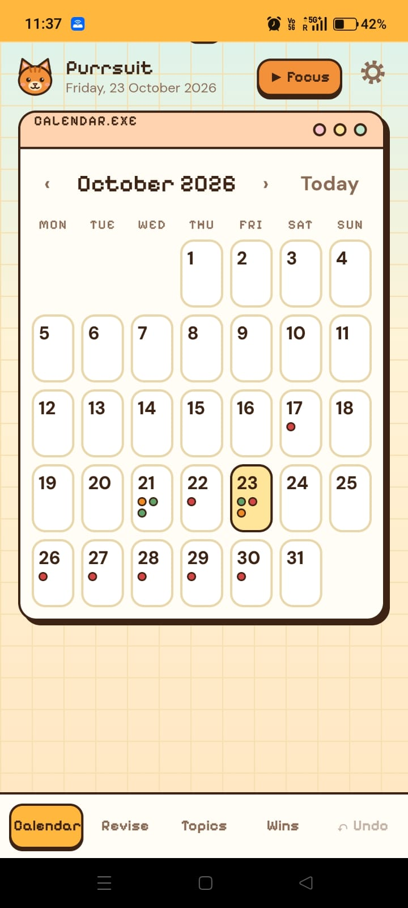
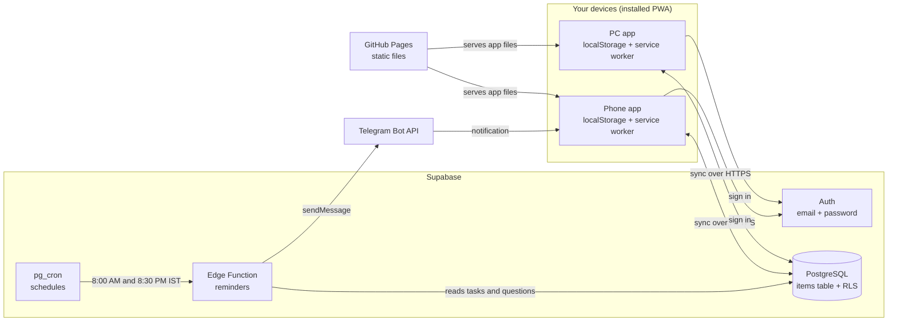
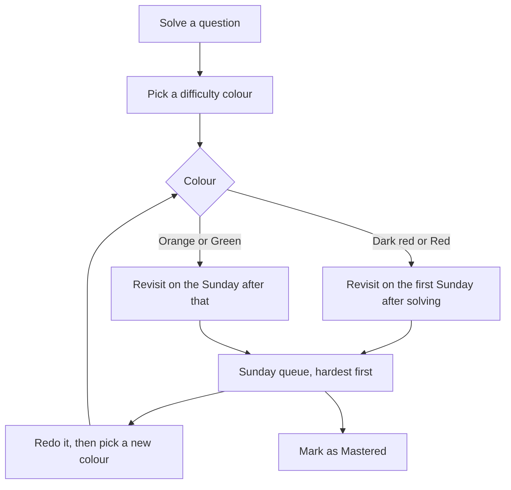
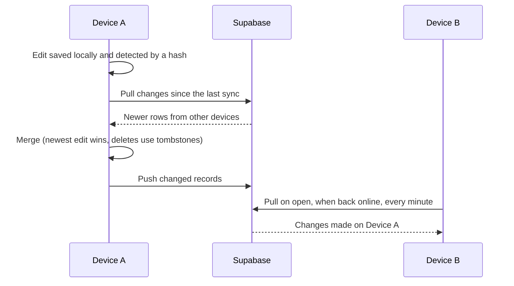

<div align="center">


# Purrsuit

**A cozy, offline-first planner that runs your day: tasks, spaced-repetition for coding questions, a focus timer and Telegram reminders, all led by a ginger cat.**

[Live app](https://dewanshi-goel.github.io/Purrsuit/) · [Screenshots](#screenshots) · [Architecture](#architecture) · [Run your own](#run-your-own-copy)

   

</div>

<p align="center">
  
</p>

---

## What is Purrsuit?

Purrsuit started as a fix for a personal problem: I was logging solved DSA questions in an Excel sheet, forgetting to revisit them at the right time, and losing track of everything else I had to do. It is a single-user planner that brings all of that into one place and works on both my PC and my phone, even with no internet.

You plan tasks on a **month calendar**, log solved **DSA and quant questions** with a difficulty colour, and the app decides **which questions to revise on which Sunday**. A **focus timer** tracks study time, a **Wins** page shows how much you have achieved, and a **Telegram bot** sends daily reminders, even when your devices are off.

## Features

- **Calendar** with a month view. Each date shows its tasks; tap a date to add tasks or log solved questions for that day. Drag a task to another day on a PC.
- **Tasks** with urgency colours, editing, moving between days, and **repeating tasks** (daily, weekdays, weekly, monthly).
- **Spaced revision for coding questions** with four difficulty colours. Questions come back on Sundays, hardest first, and each revision asks you to re-rate the question so it re-enters the queue.
- **Smart topic grouping.** Type topics freely (`hashmap, dll`). Purrsuit cleans them up, maps aliases to one group (for example, hashmap and dictionary go to Hash Table), fixes typos, and files a question under every topic it belongs to.
- **Focus timer** with start, pause, resume and end. Several sessions in one day add up to one daily total.
- **Wins page.** Total questions solved (no colour coding, just encouragement), study time, streaks, a 12-week activity grid, and a place to log projects and skills.
- **Telegram reminders.** Today's tasks every morning, the Sunday revision list, and an evening check-in if nothing was logged.
- **Offline first.** Everything works without internet and syncs when you are back online.
- **Sync across devices** through Supabase, with sign-in and per-user row security.
- **Light and Night themes**, undo for recent actions, JSON backup and restore, and small touches like paw-burst celebrations and vibration on phones.

## Screenshots

| Calendar (phone) | Day panel | Sunday revision |
|---|---|---|
|  |  |  |

| Topics | Wins and study time | Focus timer |
|---|---|---|
|  |  |  |

| Night theme | Telegram reminder |
|---|---|
|  |  |

## Tech stack

| Layer | Technology |
|---|---|
| App | HTML, CSS and plain JavaScript in a single `index.html` (no framework, no build step) |
| Installable and offline | Progressive Web App: `manifest.webmanifest` and a service worker (`sw.js`) |
| Local storage | Browser `localStorage` (the whole app state as JSON) |
| Cloud data | Supabase PostgreSQL (one `items` table) |
| Auth and security | Supabase Auth (email and password) with Row Level Security |
| Sync | `fetch` calls to Supabase's REST and Auth endpoints (no client library) |
| Reminders | Supabase Edge Function (TypeScript on Deno), scheduled with `pg_cron` and `pg_net`, sending through the Telegram Bot API |
| Hosting | GitHub Pages (HTTPS) |
| Look and feel | CSS variables for themes, embedded fonts (Pixelify Sans and DM Sans), an inline SVG cat mascot |
| Browser APIs | Service Worker, Cache API, drag and drop, Vibration API, `matchMedia`, `Intl` time zones, `navigator.storage.persist()` |

## Architecture



**Key ideas**

- **Local first.** The app reads and writes the browser's storage, so it is instant and works offline. The cloud is a copy that keeps devices in step, not a dependency.
- **One generic table.** Every record (question, task, win, focus day, repeating-task template, settings) is a row in `items` with a `kind`, a JSON `data` field, a `modified` time and a `deleted` flag.
- **Security.** Row Level Security limits every row to its owner, public sign-up is switched off, there is no permission to hard-delete rows, and only the public (publishable) key is in the page.

## Workflow

### Daily use

1. Open Purrsuit on your PC (it can start at login) or your phone.
2. Tap a date on the calendar and add tasks, or log the DSA and quant questions you solved, with a difficulty colour.
3. Start the focus timer when you begin studying. End the session and it is added to the day's total.
4. Check the Wins page when you need a boost.
5. Telegram messages you each morning with the day's tasks, and on Sundays with what to revise.

### Revision loop



| Colour | Meaning | Revisit on | Queue order |
|---|---|---|---|
| Dark red | Very hard | First Sunday after solving | 1st |
| Red | Hard | First Sunday after solving | 2nd |
| Orange | Medium | The Sunday after that | 3rd |
| Green | Easy | The Sunday after that | 4th |

Revision happens only on Sundays, so weekdays are free for new questions. The Sunday queue shows at most 10 questions, and the rest roll forward.

### Sync



- Each record is merged separately, and the newest edit wins.
- Deleted items are recorded as "tombstones", so a delete reaches the other device.
- Study time keeps the larger total, because it only ever grows.

### Reminders

1. `pg_cron` runs two jobs (08:00 and 20:30 India time, set in UTC).
2. Each job calls the `reminders` Edge Function with a secret header.
3. The function reads your data, decides what to say (tasks for today, the Sunday revision list, or an evening check-in if nothing was logged), and sends it through the Telegram Bot API.

## Project structure

```
Purrsuit/
├── index.html               # the whole app (HTML, CSS, JavaScript)
├── manifest.webmanifest     # makes it installable
├── sw.js                    # service worker for offline use
├── cat-icon-192.png         # app icons
├── cat-icon-512.png
├── reminders-function.ts    # Supabase Edge Function for Telegram reminders
├── docs/
│   ├── screenshots/         # images used in this README
│   └── specifications.md    # full specification, problems faced, interview notes
└── README.md
```

## Run your own copy

Purrsuit is a static site, so you can use it with **no setup at all**: open the live app, choose "Not now" when asked to sign in, and your data stays in your own browser. To get sync and reminders you need your own backend.

<details>
<summary><b>1. Host the app (GitHub Pages)</b></summary>

1. Fork or copy this repository.
2. Go to **Settings, then Pages**, choose **Deploy from a branch**, pick `main` and the root folder.
3. Open `https://<your-username>.github.io/<repo-name>/` and install it from the browser.
</details>

<details>
<summary><b>2. Add cloud sync (Supabase)</b></summary>

1. Create a free project at [supabase.com](https://supabase.com).
2. In the **SQL Editor**, run:

```sql
create table public.items (
  user_id uuid not null default auth.uid() references auth.users(id) on delete cascade,
  id text not null,
  kind text not null,
  data jsonb not null default '{}'::jsonb,
  modified bigint not null default 0,
  deleted boolean not null default false,
  synced_at timestamptz not null default now(),
  primary key (user_id, id)
);
create index on public.items (user_id, synced_at);
alter table public.items enable row level security;
create policy "read own" on public.items for select to authenticated using (user_id = auth.uid());
create policy "add own" on public.items for insert to authenticated with check (user_id = auth.uid());
create policy "edit own" on public.items for update to authenticated using (user_id = auth.uid()) with check (user_id = auth.uid());
create function public.touch() returns trigger language plpgsql as $$
begin new.synced_at = now(); return new; end $$;
create trigger items_touch before insert or update on public.items for each row execute function public.touch();
```

3. Under **Authentication, Users**, add your own user (email and password), then **turn off "Allow new users to sign up"**.
4. In `index.html`, replace `SB_URL` and `SB_KEY` (near the sync code) with your project's URL and **publishable** key.

Never put a secret or `service_role` key in the app.
</details>

<details>
<summary><b>3. Add Telegram reminders (optional)</b></summary>

1. Create a bot with **@BotFather** in Telegram and keep its token private. Press Start on your bot and send it a message, then find your chat ID (for example, with the bot's `getUpdates` page).
2. In Supabase, create an Edge Function named `reminders` from `reminders-function.ts`, and **turn off "Verify JWT"** for it.
3. Add these secrets: `TELEGRAM_BOT_TOKEN`, `TELEGRAM_CHAT_ID`, `CRON_SECRET` (any long random phrase), and optionally `APP_URL`.
4. In the SQL Editor, schedule the jobs (times are UTC, so `30 2` is 8:00 AM in India):

```sql
create extension if not exists pg_cron;
create extension if not exists pg_net;

select cron.schedule('planner-morning', '30 2 * * *', $$
  select net.http_post(
    url := 'https://YOUR_PROJECT_ID.supabase.co/functions/v1/reminders?mode=morning',
    headers := '{"Content-Type":"application/json","x-cron-secret":"YOUR_CRON_SECRET"}'::jsonb,
    body := '{}'::jsonb);
$$);

select cron.schedule('planner-evening', '0 15 * * *', $$
  select net.http_post(
    url := 'https://YOUR_PROJECT_ID.supabase.co/functions/v1/reminders?mode=evening',
    headers := '{"Content-Type":"application/json","x-cron-secret":"YOUR_CRON_SECRET"}'::jsonb,
    body := '{}'::jsonb);
$$);
```

Add `?test=1` to the function URL in a one-off `net.http_post` call to send a test message.
</details>

## Privacy and security

- Your data lives in your browser and, if you sign in, in your own Supabase project. There is no analytics or tracking.
- The only key in the page is Supabase's **publishable** key, which is designed to be public and is useless without a signed-in account.
- Bot tokens, the cron secret and database passwords live only in Supabase secrets and are never committed to this repository.
- The cloud copy is not end-to-end encrypted. It is protected by login and database rules, which is appropriate for study tasks but not for highly sensitive data.

## Limitations and roadmap

**Current limitations:** single user, `localStorage` size limits, newest-edit-wins sync (two offline edits to the same item keep only one), fixed revision intervals, Telegram instead of WhatsApp.

**Ideas for later:** carry unfinished tasks to the next day, ambient focus sounds, a daily progress ring, a weekly review page, search, a quick-add hotkey on the PC, a Pomodoro countdown mode, and IndexedDB storage.

<p align="center">Made with 🐾 by <a href="https://github.com/dewanshi-goel">Dewanshi</a></p>
